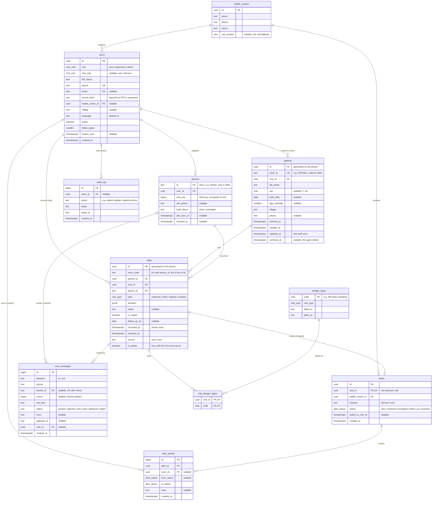

# HealthBridge ERD

Drawn from the live schema, [server/prisma/schema.prisma](../server/prisma/schema.prisma) (PostgreSQL), so it
matches the implemented database: same tables, column names, keys and relationships. GitHub renders the
Mermaid diagram below; paste it into [mermaid.live](https://mermaid.live) to export a PNG for the report.

`PK` primary key, `FK` foreign key, `UK` unique. CHECK constraints (in the migration SQL) are noted in comments.

## How the data is organised

- **One health centre, many people.** A supervisor and CHWs belong to a health centre; a supervisor only sees
  alerts for their own centre (enforced in the API, [server/src/supervisor/routes.ts](../server/src/supervisor/routes.ts)).
- **A CHW owns their patients and visits.** `patients.chw_id` and `visits.chw_id`; sync refuses a change to
  another CHW's record.
- **IDs are made on the phone.** Patients and visits get a UUID offline, so a retried upload is recognised and
  stored once.
- **An urgent visit raises one alert** (`alerts.visit_id` is unique), whether it arrived over the internet or
  by SMS; `alert_events` keeps every status change and who made it.
- **SMS log.** Every SMS in or out is in `sms_messages`; `(device_id, nonce)` is unique so a replayed SMS is
  refused.
- **Nothing is deleted.** Archiving sets `patients.archived_at`; `audit_log` records creates, updates and
  archives.

## On the phone

The app keeps its own encrypted SQLite copy (drift, [lib/data/db.dart](../lib/data/db.dart)): `patients`,
`visits` and `visit_danger_signs` mirror the tables above, plus phone-only tables: `outbox` (changes waiting to
upload), `urgent_dispatch` (each urgent alert's SMS state), `drafts` (half-filled forms), `sync_meta` and a copy
of `danger_signs`.
