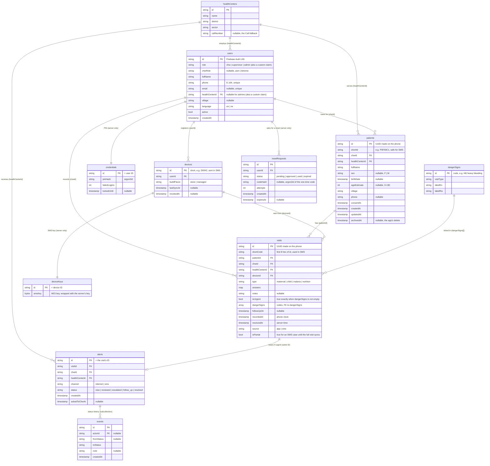

# HealthBridge ERD (Cloud Firestore)

The database is Cloud Firestore, project `healthbridge-rwanda`, location `africa-south1`. Each box below is a
top-level collection (or a subcollection, marked); field names are exactly those stored and checked by
[firestore.rules](../firestore.rules). Paste the diagram into [mermaid.live](https://mermaid.live) to export a
PNG for the report.

`PK` is the document ID, `FK` a field holding another document's ID. Firestore has no joins or foreign-key
constraints; the relationships are kept by the app and the server and checked by the security rules (for
example, a visit may only point at a patient owned by the same CHW).

Server-only collections (no app can read or write them; only the Express server through the Admin SDK):
`credentials`, `deviceKeys`, `resetRequests`, and the logs `smsMessages` and `auditLog`.

## How the data is organised

- **Ownership is on every record.** Patients, visits and alerts carry `chwId` and `healthCenterId`, so the
  rules can check access on the document itself: a CHW reads and writes only their own, a supervisor reads
  their health centre's.
- **Roles live in the sign-in token.** The server sets `role` and `hc` as Firebase Auth custom claims when an
  admin creates the account; the rules read them from `request.auth.token`, so a user cannot raise their own
  access.
- **IDs are made on the phone.** A patient or visit gets a UUID offline; a write repeated after a dropped
  connection lands on the same document instead of creating a second one.
- **One alert per urgent visit.** The alert's document ID is the visit's ID. The phone creates the internet
  alert; an alert that arrives by SMS is created by the server. Status changes go through the server, which
  checks the allowed transitions, writes an `events` document and texts the CHW.
- **Nothing is deleted.** Archiving sets `patients.archivedAt`; the rules refuse deletes.
- **Secrets stay on the server.** PIN hashes, device SMS keys and reset codes are in collections the rules
  close to every app.

## Indexes

[firestore.indexes.json](../firestore.indexes.json): alerts by health centre, status and time (the supervisor
inbox), alerts by health centre and time, visits by CHW and time, users by health centre and role.
